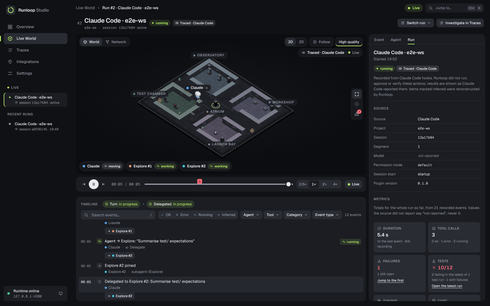
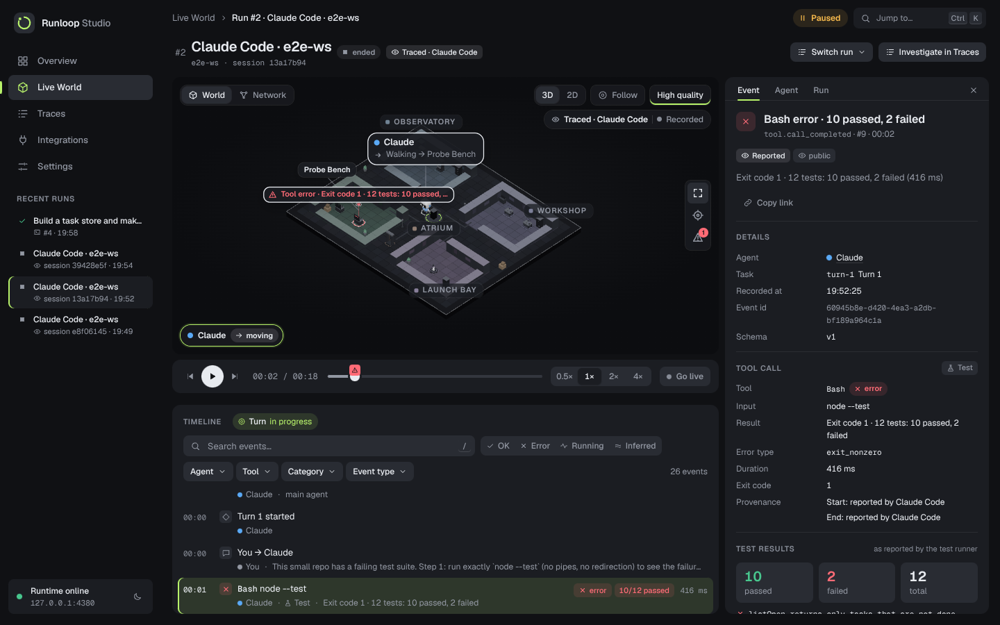
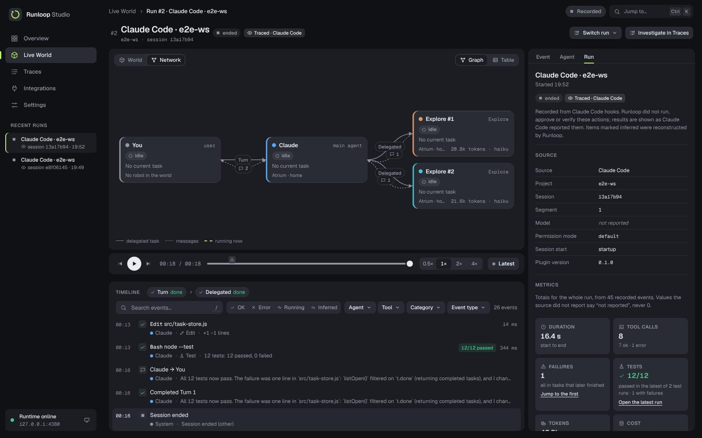

# Runloop

A local flight recorder for coding agents. Runloop records every event of an agent run in an append-only log on your machine, shows the run live as a small 3D world with a timeline and an inspector, and replays any moment without executing anything again.



**Status: prototype.** It records two sources today:
- **Claude Code sessions**, traced through a plugin. Runloop records what Claude Code reports and never runs or approves anything itself.
- **A scripted demo mission**, executed by Runloop's own runtime with real tools.

Run comparison (baselines and diffs) is the next milestone; see [TASKS.md](TASKS.md).

## Quickstart

You need Node 22.16 or newer and pnpm 10.

```sh
pnpm install
pnpm dev     # runtime API on http://127.0.0.1:4380, Studio on http://localhost:3000
```

Open http://localhost:3000 and click **Run demo mission**. Three scripted agents survey a small repo, implement a task store and run its test suite. The first test run really fails (10 passed, 2 failed). The Builder then patches the bug, and the rerun passes 12/12. Click a timeline row or a robot to inspect its events. Drag the replay bar to see any earlier moment.

Runs are stored in `.runloop/` at the repo root (set `RUNLOOP_DATA_DIR` to use another directory). They survive runtime restarts and replay from the log.

## Trace Claude Code

With the runtime running (`pnpm dev` or `pnpm serve`), start Claude Code with the plugin from this checkout:

```sh
claude --plugin-dir ./integrations/claude-code-plugin
```

Or install it from the marketplace, inside Claude Code:

```
/plugin marketplace add argahv/runloop
/plugin install runloop-tracer@runloop
```

Install it only once: with both a checkout and a marketplace copy, every event is sent twice.

Use Claude Code as usual. The session appears in Studio live, with:
- a robot for the main agent and one for each subagent (up to 8);
- tool calls at stations by kind (reading in the Observatory, edits and commands in the Workshop, tests in the Test Chamber);
- failing commands as incidents, with the reported exit code and output summary;
- subagent token usage as Claude Code reports it. The main agent's usage shows as "not reported", because hooks do not expose it.

To check the setup, run `node integrations/claude-code-plugin/scripts/runloop-hook.mjs --doctor`. It prints the runtime URL, the token file, whether the runtime answers, the spool and the last error.

| Claude Code session | Failing test as an incident | Network view (2D) |
|---|---|---|
|  |  |  |

These screenshots come from a real `claude -p` session (Haiku) traced end to end; see the [verification report](docs/status/verification-report.md).

**What is collected.** The plugin sends these to the local runtime only:
- the session id;
- prompts and Claude's final replies (marked sensitive);
- tool names and summarised inputs;
- result sizes and counts, plus the tail of command output, used to read test counts;
- the model and token usage Claude Code reports for subagents;
- the project's base name (never its absolute path).

File contents, diffs, full command output and transcripts are never collected. Well-known credential formats (API keys and tokens, URL passwords, `Authorization` headers, `password=…` style assignments, `curl -u`, `mysql -p`) and credential-like environment variables are masked in the plugin and again in the runtime; a secret in a form not on that list is stored as is, so shell commands are marked sensitive. The exact list, settings and opt-outs are in the [plugin README](integrations/claude-code-plugin/README.md).

**Trust labels.** Every traced event is marked *reported* (Claude Code said it) or *inferred* (Runloop reconstructed it). An example of an inferred event is a denied permission, which fires no hook. The Studio shows these labels and never presents a traced result as verified.

## Commands

```sh
pnpm dev           # runtime + Studio
pnpm serve         # runtime only (port 4380; --port to change it)
pnpm demo          # run the demo mission headless and print one trace line per event
pnpm test          # unit, integration and end-to-end tests (vitest)
pnpm typecheck
pnpm build         # static export of the Studio (apps/studio/out)
pnpm screenshots   # visual regression screenshots of every page (needs a runtime and Studio running)
```

## How it works

Three layers stay strictly apart:

1. **Execution truth.** The append-only event log. Tool results come only from tools that really ran (executed runs) or from what the source reported (traced runs).
2. **World simulation.** A pure function of the log and a world definition: where each robot is and what it is doing.
3. **Presentation.** The Studio draws layer 2 and never writes back to it.

Live view and replay fold the same events through the same reducers, so they always agree. More detail:
- [Architecture overview](docs/architecture/overview.md)
- [Event model](docs/architecture/event-model.md)
- [Claude Code tracer design](docs/plans/claude-code-tracer.md)
- [Design system](docs/design/design-system.md)
- [Current state](docs/status/current-state.md)

## Security notes

- The runtime listens on loopback only. Ingest from the plugin needs a per-user token (`~/.config/runloop/ingest-token`, created by the runtime) and rejects browser requests.
- **Read endpoints are not authenticated.** Any local process of yours can read recorded runs, including prompts and commands, just as it can read the database file.
- In the demo, `run_command` executes the workspace's tests as your user, without OS-level isolation. That is safe for the fixed demo code. Read the sandbox notes in [packages/runtime/README.md](packages/runtime/README.md) before connecting an adapter that writes its own code.

## Repository layout

```
apps/studio                    Next.js Studio: Overview, Live World (3D + Network), Traces, Integrations, Settings
packages/events                event schema, parsing, redaction, SequenceBuffer, HTTP/SSE and ingest contract
packages/core                  layer 1: execution reducer, selectors, text formatting
packages/world-engine          layer 2: world definition, grid paths, motion, character intents
packages/replay                combined reducer and ReplayIndex (state at any sequence or time)
packages/runtime               local runtime: SQLite recorder, tool sandbox, run manager, Claude Code ingest, HTTP + SSE API, CLI
packages/testkit               fixtures and helpers for tests
integrations/claude-code-plugin  the Claude Code plugin (observe-only hooks, spool, --doctor)
worlds/research-campus         the default world (rooms, stations, presets)
examples/coding-mission        the demo mission and its example repo
scripts/screenshots.mjs        visual regression screenshots (Playwright)
docs/                          strategy, architecture, plans, design system, status
```

## License

Apache-2.0. See [LICENSE](LICENSE).
