# Runloop

**A world, not a dashboard.** Runloop is a small town that lives on your machine, and you step into it like a game. Simulated residents keep its streets busy; your real AI agents move in as buildings in the Agent District. When Claude Code works in a project you added, its building lights up, its robots go to work by kind of tool, a failing test shows as an incident, and every session can be replayed, traced and compared without leaving the town.

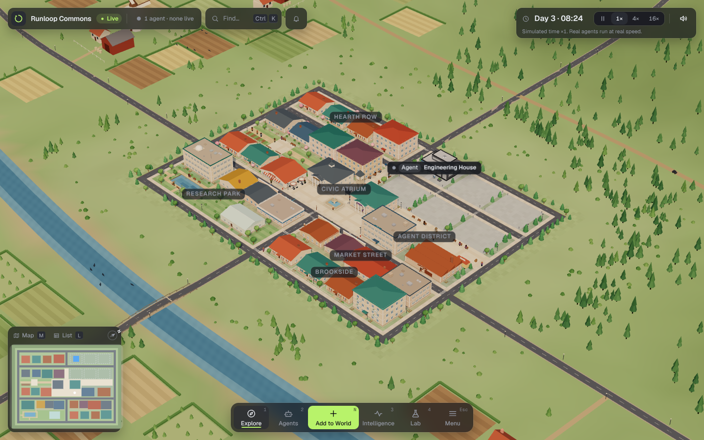

**Status: prototype.** What it does today:
- **The town** (Runloop Commons): 80 simulated residents with needs, schedules and friendships, 28 buildings, a day and night that follow the simulated clock. It is deterministic and persistent: it pauses while Runloop is off and says so when it resumes.
- **A game you stay in:** the town fills the screen and the land runs on to the horizon; a free camera (pan, zoom, turn, tilt, follow, fly into buildings); a HUD with the clock, a minimap, a hotbar, cards next to what they describe and an Esc menu. Traces, compare, sessions, settings and Add to World all open inside the town. A calm, synthesized soundscape follows the camera; event sounds play only for real agent events.
- **Real agents:** Claude Code sessions, traced through a plugin. Runloop records what Claude Code reports and never runs or approves anything by itself.
- **Assign a task** to an agent (optional): Runloop shows the exact `claude -p` command, and runs it only after you approve it.
- **Runs, replay and compare:** every session's events, a run diorama, Traces, and Experiments to compare two runs. A scripted demo mission shows them without Claude Code.

See [TASKS.md](TASKS.md) for what is next.

## Quickstart

You need Node 22.16 or newer and pnpm 10.

```sh
pnpm install
pnpm dev     # runtime API on http://127.0.0.1:4380, Studio on http://localhost:3000
```

Open http://localhost:3000: that is the town, edge to edge. Residents walk to work, eat, meet on benches and go home; the clock reads "Day 1 · 08:00" on a new world. Pause it, or run it at 1×, 4× or 16× (real agents always run at real speed). Click a resident to follow them and see what they are doing and **Why**: every reason links to the recorded decision event it came from. Double-click a building to fly inside; ⌘K / Ctrl-K finds anyone.

### Controls

| | Mouse and touch | Keys |
|---|---|---|
| Move | drag · one finger | W A S D, arrows |
| Zoom (toward the pointer) | wheel · pinch | + − · 0 whole town |
| Turn · tilt | right-drag · two-finger twist; two fingers up or down tilt | Q E · Z X · R reset |
| Select · follow | click a resident or robot (it is followed) | F follow, Esc stop |
| Enter a building | double-click · double-tap | Enter |
| Modes | the hotbar | 1 Explore · 2 Agents · 3 Intelligence · 4 Lab · N Add to World |
| Views | the minimap's Map and List | M 2D map · L directory of everyone and everything · H hide the HUD |
| Menu | ☰ on the hotbar | Esc (backs out one step at a time, then opens the menu) · ? keyboard map |

The Esc menu holds Display (theme, quality, motion, the 2D map instead of 3D), Sound, Controls, Runtime, Connections and links to every full page. With reduced motion the camera cuts instead of flying and the decorative life stands still; without WebGL the town is drawn as a 2D map with the same HUD. On a phone the town is a lighter 3D scene with touch gestures and cards as bottom sheets.

**Sound** is synthesized in the browser (no audio files): birds and breeze by day, crickets at night, a murmur near the café and the fountain, distant traffic, and soft interface sounds. Four cues play only for real agent events (an agent goes live, needs approval, hits an incident, finishes a task), never for simulated activity, and each is also a notification. Nothing plays before your first click or key press; a hidden tab is silent. The speaker button (top-right) mutes it; Esc › Sound has the volumes and "reduce sound".

The town and its log are stored in `.runloop/` at the repo root (set `RUNLOOP_DATA_DIR` to use another directory) and survive restarts. `RUNLOOP_WORLD=off` runs Runloop without the town.

## Add Claude Code to the world

1. Press **N** (or **Add to World** on the hotbar). The camera flies to the Agent District and the free lots light up with an outline and a label; click one (or its label button). A card on the lot asks for a name (for example "Engineering House") and the absolute path of a project folder. The building appears as an unpainted model: *waiting for its first event*.
2. Start Claude Code in that folder with the Runloop plugin (with the runtime running):
   ```sh
   claude --plugin-dir /path/to/runloop/integrations/claude-code-plugin
   ```
   or install the plugin once from the marketplace (see [Trace Claude Code](#trace-claude-code)).
3. On the first prompt the building goes **live** (in about a second) and the Add to World card hands over to the agent's own card, which says its health as it is (live, idle, an incident, offline). The card shows what the session is doing by kind of tool, its subagents, and a failing command as an incident. **Enter building** shows the session's robots at their stations and a session strip: pick a session, scrub it (the diorama shows the recorded state at the playhead), open its **Trace** or **Compare** it, all inside the town.
4. When the session ends the agent reads *offline*; the town keeps living. Sessions from other folders wait under **Agents › Arrivals**, where you can claim them for an agent.

| A live agent and its card | Inside the agent's building |
|---|---|
| 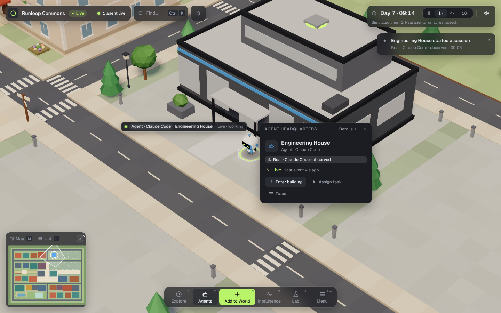 | 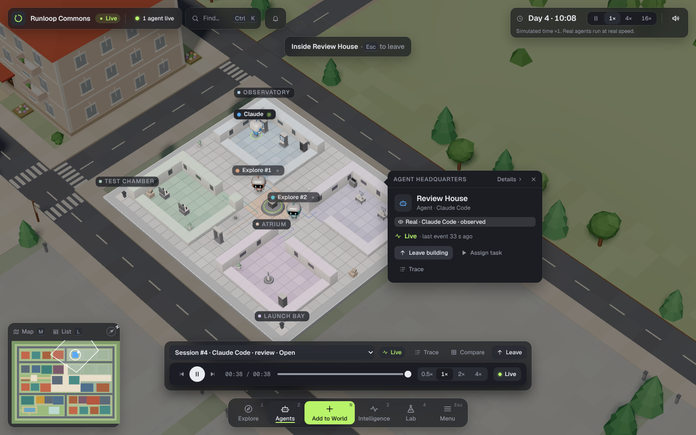 |
| **Add to World: pick a lot in the town** | **A resident's Why, in a card next to them** |
| 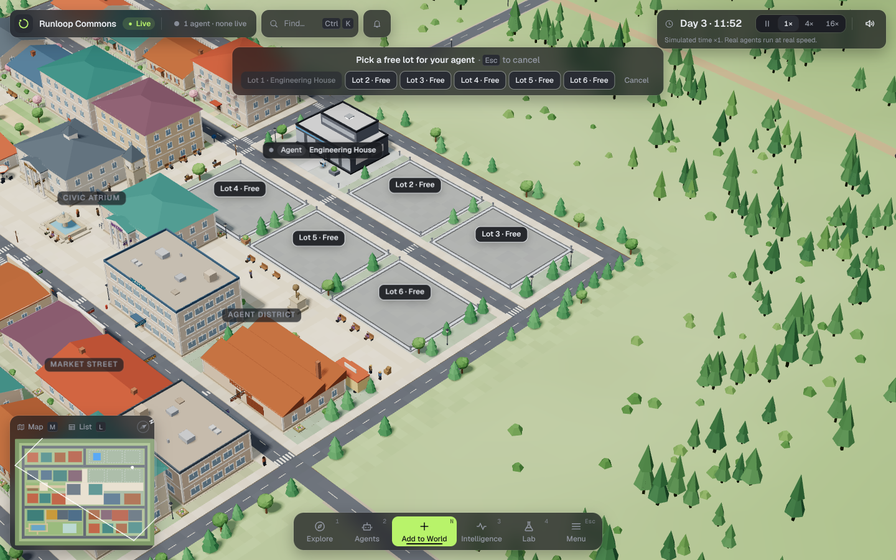 | 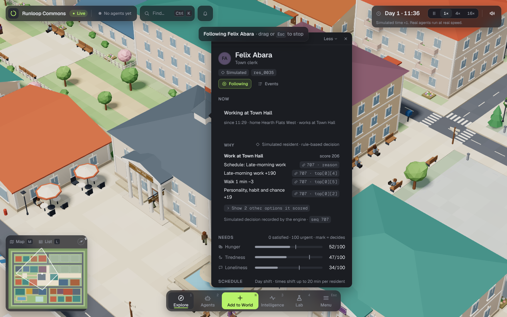 |
| **Assign task: a real dispatched run, done** | **Night in the Commons** |
| 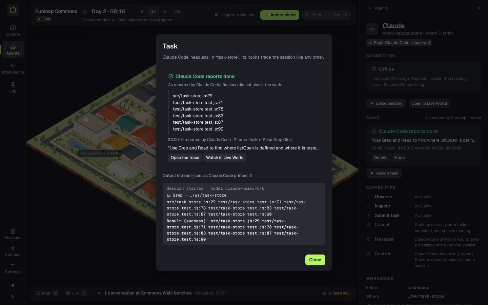 | 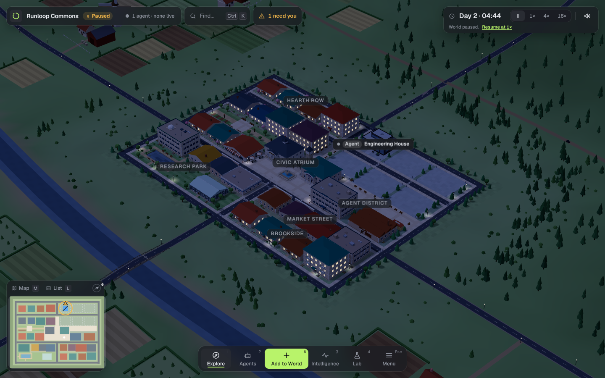 |

| The horizon, tilted low | Intelligence: a trace beside the live town |
|---|---|
| 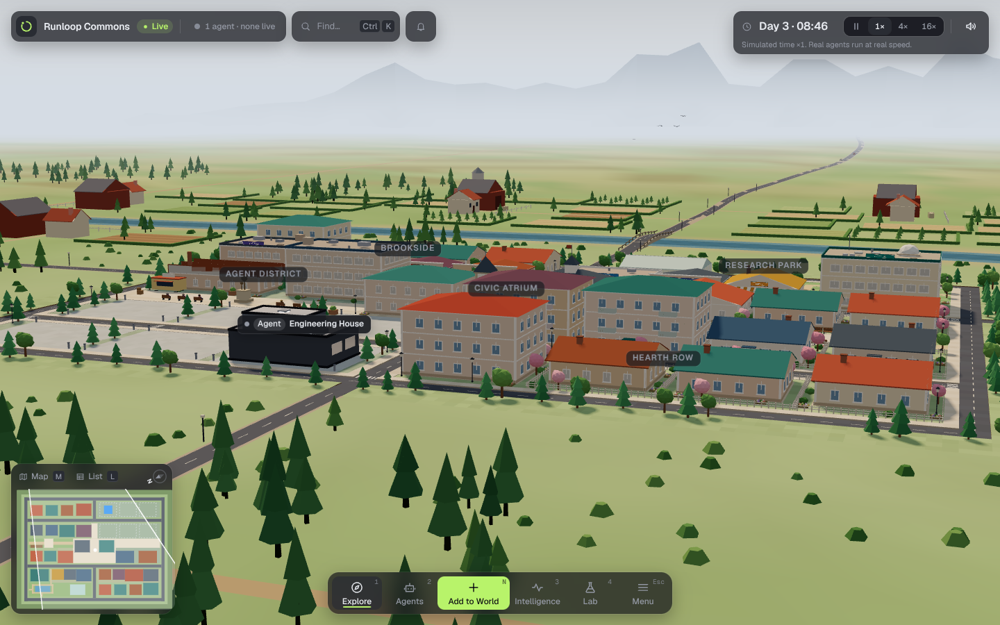 | 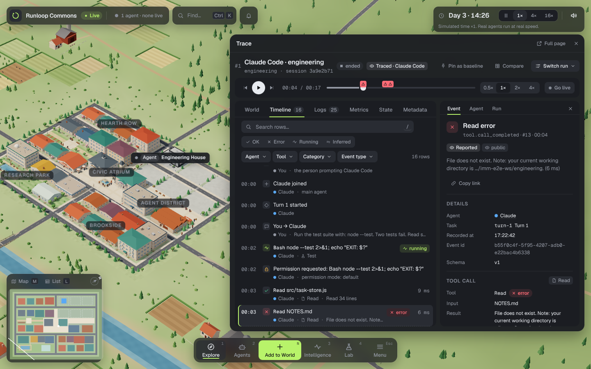 |
| **Lab: compare two runs at the Lattice Lab** | **Inside the Corner Café** |
| 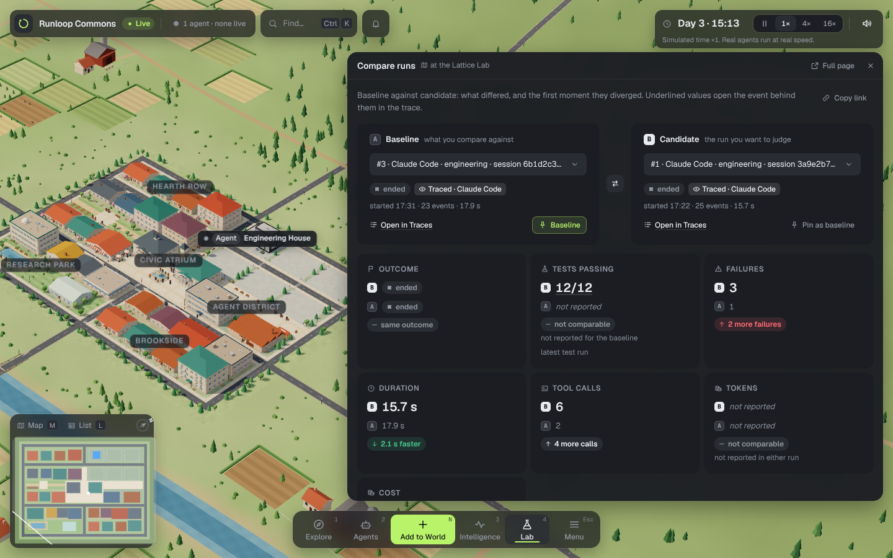 | 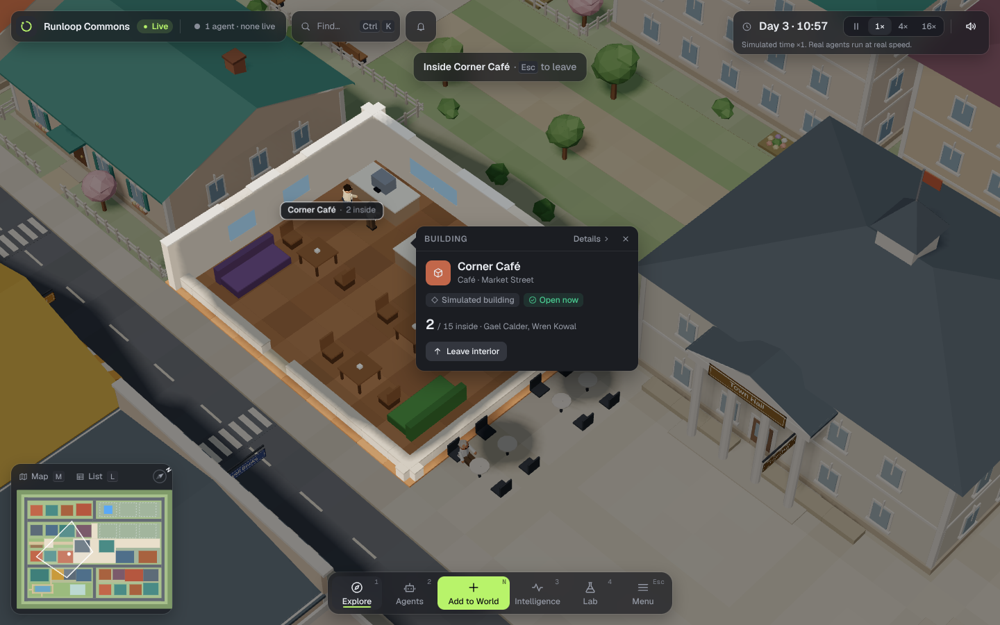 |

### What is real and what is simulated

- **Residents are simulated.** They carry a ◇ *Simulated* label. Their decisions come from a rule-based engine (needs, schedules, traits), and their **Why** shows only the factors recorded in the decision event, each linked to it. No language model invents a reason.
- **Agents are real.** An agent building shows only what Claude Code's hooks reported (*Real · Claude Code · observed*) or what Runloop inferred from it, labelled *inferred*. An agent that has sent no event is never shown as live; unknown values read *not reported*.
- Every event in the town's log has a provenance: `simulation`, `user` (you), `external-agent`, `system` (Runloop) or `inferred`. The World Log (**Intelligence**) filters by it.
- The project folder's absolute path stays on your machine: the world, its events and the API only ever show the folder's name and a short hint.

### Assign a task (dispatch)

An agent's card has **Assign task**. Write the task, pick a preset and a budget, and **Preview command**: Runloop shows the exact `claude -p` command, model, tools, budget, timeout and the names of the environment variables it passes. **Approve in Runloop…** opens the runtime's own approval page in a window; it shows the same command, and nothing runs until you approve it there. The Studio follows the outcome and then shows the task's output.

- **Presets:** *Read-only* (`Read Grep Glob`) or *Edit + test* (adds `Edit`, `Write` and `Bash(pnpm test:*)`), with `--permission-mode dontAsk`: any other tool is refused, never asked.
- **Limits:** haiku by default; the budget (default $0.25, at most $1) is enforced by Claude Code with `--max-budget-usd`; the timeout (default 10 min) by Runloop; at most one running task per agent and two in total. **Cancel** stops the whole process group.
- **Billed to your Anthropic account. Edits land in your working tree. "Done" is what Claude Code reports**; Runloop does not check the work.
- Approval happens only on the runtime's own page (`/approve/<previewId>`: no CORS, unframeable, a short minimum review), with a single-use nonce bound to the exact command. No web page, the Studio included, can approve a task by itself. Local processes are trusted, as for the rest of the API (see Security notes). Every step is written to an audit log. `RUNLOOP_DISPATCH=off` turns dispatch off.

### The demo mission

Without Claude Code, open **Sessions** (Esc › Pages, ⌘K "Sessions", or `/overview`) and click **Run demo mission**; it opens in the town, in the trace sheet's World tab. Three scripted agents survey a small repo, implement a task store and run its test suite. The first test run really fails (10 passed, 2 failed); the Builder patches the bug and the rerun passes 12/12. Drag the replay bar to see any earlier moment.

## Trace Claude Code

With the runtime running (`pnpm dev` or `pnpm serve`), start Claude Code with the plugin from this checkout:

```sh
claude --plugin-dir ./integrations/claude-code-plugin
```

Or install it from the marketplace, inside Claude Code:

```
/plugin marketplace add argahv/runloop
/plugin install runloop-tracer@runloop
```

Install it only once: with both a checkout and a marketplace copy, every event is sent twice.

Use Claude Code as usual. The session appears in Studio live, with:
- a robot for the main agent and one for each subagent (up to 8);
- tool calls at stations by kind (reading in the Observatory, edits and commands in the Workshop, tests in the Test Chamber);
- failing commands as incidents, with the reported exit code and output summary;
- subagent token usage as Claude Code reports it. The main agent's usage shows as "not reported", because hooks do not expose it.

To check the setup, run `node integrations/claude-code-plugin/scripts/runloop-hook.mjs --doctor`. It prints the runtime URL, the token file, whether the runtime answers, the spool and the last error.

### Compare two sessions

1. Run a task with Claude Code and click **Pin as baseline** on that run (the run header, or the run history on Overview).
2. Change one thing (CLAUDE.md, a skill, a subagent, a hook, the model) and run the same task again.
3. Press **4** for the Lab (or **Compare** in the new run's header, or `/experiments`). The baseline defaults to your newest pin and the candidate to the newest other run of the same project.

Experiments shows the outcome, the latest test results (fixed, newly failing, still failing), the files each run read or edited, tool calls by category, tokens and models per agent as reported, permission requests, turns and subagents, and the **first divergence**: the first tool call where the two runs went different ways. The test runs, failures, files, categories, usage reports and the divergence link to their events in Traces. A value one run did not report shows as *not reported* and is never compared; so does a token total that covers different agents in each run.

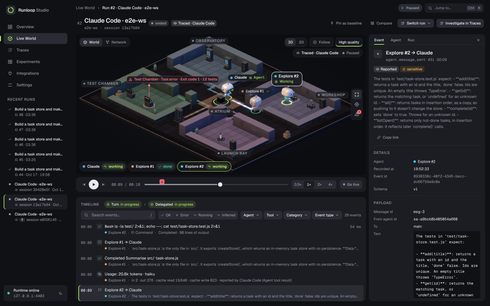

This screenshot shows a real `claude -p` session (Haiku, 2026-10-17) traced end to end; the town images above come from real sessions on 2026-10-18. See the [verification report](docs/status/verification-report.md).

**What is collected.** The plugin sends these to the local runtime only:
- the session id;
- prompts and Claude's final replies (marked sensitive);
- tool names and summarised inputs;
- result sizes and counts, plus the tail of command output, used to read test counts;
- the model and token usage Claude Code reports for subagents;
- the project's base name (never its absolute path).

File contents, diffs, full command output and transcripts are never collected. Well-known credential formats (API keys and tokens, URL passwords, `Authorization` headers, `password=…` style assignments, `curl -u`, `mysql -p`) and credential-like environment variables are masked in the plugin and again in the runtime; a secret in a form not on that list is stored as is, so shell commands are marked sensitive. The exact list, settings and opt-outs are in the [plugin README](integrations/claude-code-plugin/README.md).

**Trust labels.** Every traced event is marked *reported* (Claude Code said it) or *inferred* (Runloop reconstructed it). An example of an inferred event is a denied permission, which fires no hook. The Studio shows these labels and never presents a traced result as verified.

## Commands

```sh
pnpm dev           # runtime + Studio (the town at http://localhost:3000)
pnpm serve         # runtime only (port 4380; --port to change it)
pnpm demo          # run the demo mission headless and print one trace line per event
pnpm test          # unit, integration and end-to-end tests (vitest)
pnpm typecheck
pnpm build         # static export of the Studio (apps/studio/out)
pnpm screenshots   # visual regression screenshots: the town (horizon, street, cards, the café, Add to World, the agent and its building, sheets, the Esc menu) and every page (needs a runtime and Studio running)
node scripts/e2e-world.mjs            # the town lives: rendering, residents moving, ⌘K → Why, Follow, the café interior
node apps/studio/src/audio/check/render-check.mjs   # the soundscape in headless Chromium (autoplay, levels, settings)
node scripts/perf-town.mjs            # town render budgets (draw calls, triangles, JS per frame) under SwiftShader
pnpm --filter @runloop-world/sim bench   # simulation tick cost and events per sim day
```

Environment: `RUNLOOP_DATA_DIR`, `RUNLOOP_WORLD=off`, `RUNLOOP_DISPATCH=off`, `RUNLOOP_DISPATCH_ENV` (extra variable names passed to dispatched `claude`, e.g. `HTTPS_PROXY,NODE_EXTRA_CA_CERTS`), `RUNLOOP_TRACE=off`, `RUNLOOP_INGEST_TOKEN_FILE`, `RUNLOOP_ALLOWED_ORIGINS`; the runtime's usage text (`packages/runtime/src/cli.ts`) describes each.

## How it works

Three layers stay strictly apart:

1. **Execution truth.** The append-only event log of each run. Tool results come only from tools that really ran (executed runs) or from what the source reported (traced runs).
2. **World simulation.** Two pure functions: a run's diorama (where each robot is), and the town (residents, buildings, the clock), which has its own append-only log with a provenance on every event.
3. **Presentation.** The Studio draws both and never writes back to them; your commands (pause, open a building, Add to World) are recorded as `user` events.

Live view and replay fold the same events through the same reducers, so they always agree. The town is deterministic: the same seed and commands give the same log, in any process. More detail:
- [Architecture overview](docs/architecture/overview.md) and [world simulation](docs/architecture/world-simulation.md)
- [Event model](docs/architecture/event-model.md)
- [Claude Code tracer design](docs/plans/claude-code-tracer.md)
- [Design system](docs/design/design-system.md)
- [Current state](docs/status/current-state.md)

## Where Runloop Is Going

**Runloop is a living world, not just a window into agent execution.**

The long-term goal is to build a persistent, autonomous society where simulated residents live and work, buildings serve real purposes, organizations pursue goals, and meaningful events emerge from interactions across the world. Real AI agents can enter this society as connected participants, contribute to tasks in their actual environments, and bring their outcomes back into the world.

The world should remain meaningful even when no external agents are connected. Traces, replay, and observability are important capabilities, but they are not the ultimate product. They are tools for understanding and improving what happens inside a larger, evolving system.

### The World We Want to Build

- **A living society:** Residents have identities, needs, routines, goals, memories, and relationships that influence their decisions and the world around them.
- **Functional places:** Buildings are more than visual structures. Workplaces, laboratories, offices, and shared spaces have capabilities, resources, occupancy, and activities that shape what can happen there.
- **Organizations with purpose:** Teams and organizations work toward objectives, manage dependencies, encounter constraints, and respond to changing circumstances.
- **Real agents as participants:** External AI agents connect through explicit integrations, occupy workspaces in the world, perform authorized tasks in their real environments, and contribute observable outcomes.
- **A world that evolves:** The simulation maintains its own history and continues independently of external agent sessions, creating situations that users can explore, understand, and influence.
- **Experimentation through alternate worlds:** Users can checkpoint and fork a world, change conditions or rules, and compare outcomes to understand how different decisions affect the system.

### From Agent Monitoring to a Living System

The current prototype establishes the foundations: a persistent simulated town, resident routines, a Claude Code integration, provenance-aware event history, controlled task dispatch, and execution replay and comparison.

The next challenge is to connect these capabilities into one coherent system.

| Area | Current foundation | Direction |
|---|---|---|
| Society | Residents with needs, schedules, traits, and friendships | Meaningful goals, memory, consequential relationships, and social dynamics |
| Buildings | Spatial structures and some interiors | Functional rooms, capabilities, organizations, and shared resources |
| Agent ecosystem | Claude Code integration | A stable adapter contract and support for additional agent runtimes |
| Collaboration | Sessions and controlled task dispatch | Delegation, dependencies, handoffs, and coordination policies |
| World autonomy | Deterministic resident simulation | Explainable society-level goals and evolving situations |
| Experimentation | Replay and run comparison | World checkpoints, forks, altered conditions, and outcome comparison |
| Scale and reliability | Initial town and population benchmarks | Larger-world validation, performance budgets, and robust recovery |
| Product experience | Immersive local prototype: a full-screen 3D town with a game HUD, where every action opens inside the world | Better onboarding, accessibility, and sustained user validation |

These are product directions, not claims that every capability is already implemented. See [TASKS.md](TASKS.md) and the [current-state report](docs/status/current-state.md) for the implementation status of individual milestones.

### The Core Experience

The experience we are working toward is a world that users can:

1. **Explore** — enter a populated society and discover what residents, organizations, and connected agents are doing.
2. **Understand** — investigate events, decisions, dependencies, and the evidence behind what happened.
3. **Influence** — change conditions, create functional places, establish objectives, and shape how the world develops.
4. **Connect** — invite a real agent to perform an explicitly authorized task in its actual environment.
5. **Experiment** — fork a world, test alternative conditions, and compare the resulting behavior.
6. **Return to** — revisit a persistent world with meaningful history, new developments, unresolved problems, and opportunities for action.

### Principles That Guide Development

- **World first, traces second.** The society must have purpose and activity independent of agent-monitoring sessions.
- **Meaningful behavior over visual activity.** Residents should act for understandable reasons, not simply move to make the world appear alive.
- **Simulation and reality stay distinct.** Simulated events, externally reported activity, executed actions, and inferred information must have clear provenance.
- **Real actions require explicit boundaries.** External execution must respect permissions, approval policies, resource limits, and auditable outcomes.
- **Explainability and reproducibility matter.** Users should be able to understand why a simulated event occurred and reproduce or compare outcomes where appropriate.
- **Function before spectacle.** Visual design and motion should reveal activity, relationships, and cause and effect—not substitute for functional depth.
- **The world belongs to the user.** Persistence, recovery, data boundaries, and accessible ways to navigate and inspect the world are core product concerns.

### What Comes Next

The near-term priority is to make the world functionally meaningful before expanding its visual scope or integration count:

1. Complete functional buildings, organizations, and shared capabilities.
2. Introduce explainable project goals, dependencies, and society-level activities.
3. Demonstrate an end-to-end workflow in which an authorized real agent performs a task and its reported outcome is reconciled with the world.
4. Implement world checkpointing and experimentation without replaying real-world actions.
5. Validate that users can understand the world, accomplish useful work, and find reasons to return.

**The measure of progress is not how many residents populate the town or how many agents Runloop can trace. It is how much meaningful activity the world supports, how well users can understand and influence it, and how coherently simulated society and real AI systems work together.**

## Security notes

- The runtime listens on loopback only. Ingest from the plugin needs a per-user token (`~/.config/runloop/ingest-token`, created by the runtime) and rejects browser requests.
- **Read endpoints are not authenticated.** Any local process of yours can read recorded runs, including prompts and commands, just as it can read the database file.
- **Dispatch** starts `claude -p` only after you approve the exact command on the runtime's own approval page (see [Assign a task](#assign-a-task-dispatch)); its edits are real and its cost is billed to your account.
- In the demo, `run_command` executes the workspace's tests as your user, without OS-level isolation. That is safe for the fixed demo code. Read the sandbox notes in [packages/runtime/README.md](packages/runtime/README.md) before connecting an adapter that writes its own code.

## Repository layout

```
apps/studio                    Next.js Studio: the town (/) with its HUD, sheets and soundscape; the full pages Overview, Live World (3D + Network), Traces, Experiments, Integrations, Settings
packages/events                event schema, parsing, redaction, SequenceBuffer, HTTP/SSE and ingest contract; world contracts (world.ts)
packages/town                  the town file format: schema, compile, raster, navigation fields (pure)
packages/sim                   the town simulation: residents, decisions, applyEvent, explain, replay (pure)
packages/core                  layer 1: execution reducer, selectors, text formatting, run compare (summarizeRun, diffRuns)
packages/world-engine          layer 2: world definition, grid paths, motion, character intents
packages/replay                combined reducer and ReplayIndex (state at any sequence or time)
packages/runtime               local runtime: SQLite recorder, tool sandbox, run manager, Claude Code ingest, world host, agents, dispatch, HTTP + SSE API, CLI
packages/testkit               fixtures and helpers for tests
integrations/claude-code-plugin  the Claude Code plugin (observe-only hooks, spool, --doctor)
worlds/runloop-commons         the town: town.json and 15 interiors
worlds/research-campus         the run diorama (rooms, stations, presets); also the agent headquarters' interior
examples/coding-mission        the demo mission and its example repo
scripts/                       screenshots.mjs, e2e-world.mjs (Playwright), perf-town.mjs (render budgets)
docs/                          strategy, architecture, plans, design system, status
```

## License

Apache-2.0. See [LICENSE](LICENSE).
